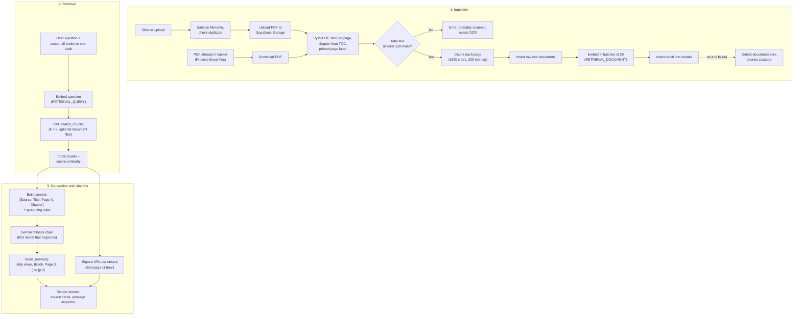
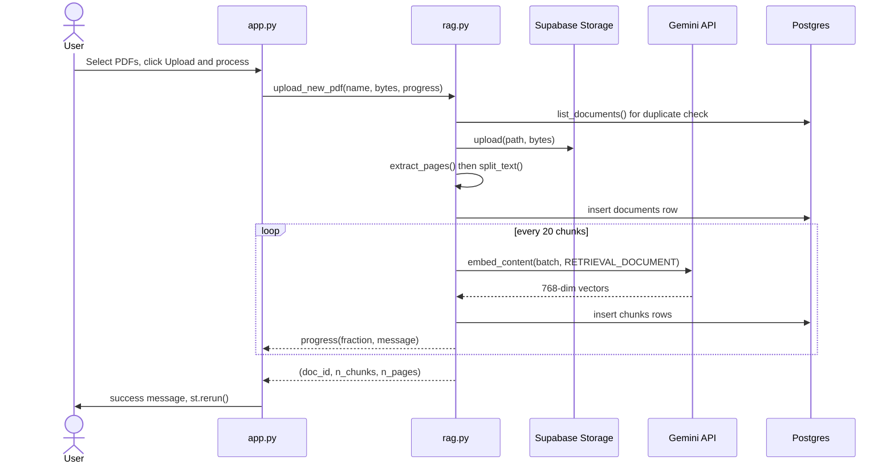
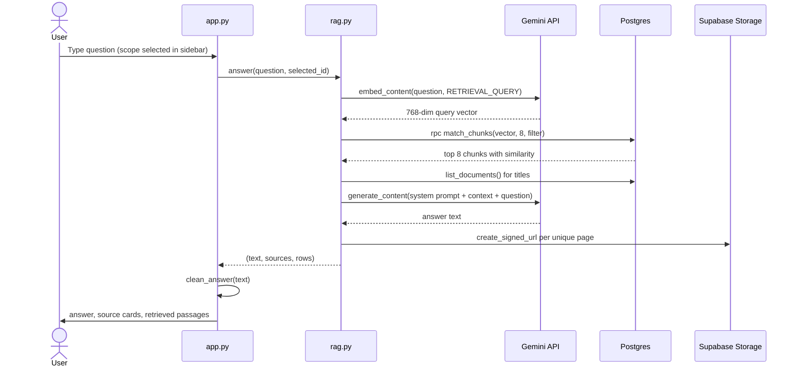

# Ask the Book: Detailed Architecture & Technical Documentation

A Retrieval-Augmented Generation (RAG) prototype. You upload PDF books, the system indexes them as vector embeddings, and you ask questions in plain language. Answers are generated only from retrieved passages and come with page-level citations plus links that open the original PDF at the cited page.

> **Status:** working prototype. It is built to demonstrate a complete RAG pipeline end to end. Section 14 lists the known limitations and how each would be fixed.

---

## Table of Contents
1. [Purpose and Scope](#1-purpose-and-scope)
2. [Tech Stack](#2-tech-stack)
3. [System Diagrams](#3-system-diagrams)
4. [Repository Layout](#4-repository-layout)
5. [`rag.py` Function Reference](#5-ragpy-function-reference)
6. [`app.py` Reference](#6-apppy-reference)
7. [Ingestion Deep Dive](#7-ingestion-deep-dive)
8. [Data Model and Vector Search](#8-data-model-and-vector-search)
9. [Query Deep Dive (Worked Example)](#9-query-deep-dive-worked-example)
10. [Citation System](#10-citation-system)
11. [Error Handling Matrix](#11-error-handling-matrix)
12. [Performance, Cost and Capacity](#12-performance-cost-and-capacity)
13. [Security](#13-security)
14. [Known Limitations and Fixes](#14-known-limitations-and-fixes)
15. [Setup, Diagnostics and Troubleshooting](#15-setup-diagnostics-and-troubleshooting)
16. [Design Decisions and Alternatives](#16-design-decisions-and-alternatives)
17. [Glossary](#17-glossary)

---

## 1. Purpose and Scope

**Problem.** Books are too long to paste into an LLM prompt, and an LLM answering from memory can invent facts. Readers also want to know *where* an answer came from.

**Solution.** Retrieve the few passages that matter, give only those to the model, and show exactly where they came from.

**Goals**
- Upload one or many PDFs and make them searchable.
- Answer in natural language, grounded in the books only.
- Cite book, printed page and chapter for every answer, and link to the exact page of the PDF.
- Let the user search all books or a single book.
- Make adding and deleting books instant and clean.

**Non-goals (current version)**
- No user accounts or per-user libraries.
- No OCR for scanned PDFs.
- No conversational memory across questions.
- No evaluation harness or automated tests.

---

## 2. Tech Stack

| Layer | Technology | Role | Why this choice |
|---|---|---|---|
| Frontend | Streamlit + custom CSS | Chat UI, sidebar, source cards | Fastest way to a working Python UI for a prototype. |
| PDF parsing | PyMuPDF (`pymupdf`) | Page text, bookmarks (TOC), printed page labels | Fast, accurate text extraction and exposes TOC and page labels. |
| Embeddings | Gemini `gemini-embedding-001`, 768 dims | Turn text into vectors | Strong multilingual embeddings; supports document/query task types and reduced dimensions. |
| Generation | Gemini chat models (fallback chain) | Write the grounded answer | Low latency and cost; chain gives resilience. |
| Database | Supabase PostgreSQL + `pgvector` | Metadata, chunks, vector search | One system for relational data and vectors; similarity search runs in SQL. |
| File storage | Supabase Storage (bucket `Book`) | Original PDFs, signed URLs | Keeps PDFs private and lets the UI link to the exact page. |
| Config | `python-dotenv` | Loads `.env` | Keeps secrets out of source control. |

---

## 3. System Diagrams

### 3.1 High-level architecture



### 3.2 Ingestion sequence



### 3.3 Question-answer sequence



---

## 4. Repository Layout

```text
RAG Assesment/
├── .env                 # Secrets (git-ignored)
├── .env.example         # Placeholder template (create this file, see section 15)
├── .gitignore           # Excludes venv, .env, __pycache__, logs, IDE files
├── app.py               # Streamlit UI
├── rag.py               # Ingestion, retrieval, generation, storage helpers
├── check_schema.py      # Confirms the documents/chunks tables exist (new version)
├── debug_query.py       # Seven-step pipeline diagnostic
├── test_connection.py   # Verifies Gemini and Supabase credentials
├── inspect_pdf.py       # Prints TOC and sample pages of a local book.pdf
├── run.bat              # Windows launcher: activate venv, run streamlit
└── ARCHITECTURE.md      # This file
```

| File | Responsibility |
|---|---|
| `app.py` | Layout and CSS, session state, sidebar controls, chat loop, source card rendering, answer cleanup. |
| `rag.py` | All backend logic and the two external clients (Gemini, Supabase). `app.py` never talks to Supabase or Gemini directly except through `rag`. |
| `check_schema.py` | Checks `documents.id` exists and that `chunks` has `document_id` and `pdf_page` (the "new version" columns). |
| `debug_query.py` | Lists documents, counts chunks, prints a sample chunk, embeds "What is RAG?", calls `match_chunks`, pings each chat model, then runs a full `answer()`. Stops at the first failing step with a clear message. |
| `test_connection.py` | Checks the three env vars exist, then tests embeddings, chat, the database and storage buckets. It hardcodes a chat model name, so keep that aligned with `CHAT_MODEL`. |
| `inspect_pdf.py` | Shows page count, the first 40 bookmarks, and sample pages with their page labels. Run it on a new book to predict how chapters and page numbers will resolve. |
| `run.bat` | `cd` to the script folder, activate `venv`, run `streamlit run app.py` with usage stats disabled. |

---

## 5. `rag.py` Function Reference

### Configuration (module level)

| Name | Value | Notes |
|---|---|---|
| `BUCKET` | `SUPABASE_BUCKET` env var, default `"Book"` | Storage bucket name (case-sensitive). |
| `EMBED_MODEL` | `"gemini-embedding-001"` | Used for both documents and queries. |
| `DIM` | `768` | Must match `vector(768)` in the `chunks` table. |
| `CHAT_MODELS` | `CHAT_MODEL` env var, then `gemini-3.5-flash-lite`, `gemini-3.1-flash-lite`, `gemini-3.5-flash` | `None` entries are filtered out. If `CHAT_MODEL` equals a fallback, it appears twice (harmless). |
| `gemini` | `genai.Client(..., timeout=60000)` | 60 second HTTP timeout. |
| `sb` | Supabase client using the service key | Bypasses row-level security. |
| `SYSTEM_PROMPT` | Five grounding rules | See section 9. |

### Helpers

| Function | Inputs / Output | What it does |
|---|---|---|
| `safe_name(name)` | filename → safe string | Replaces any run of characters outside `A-Za-z0-9._-` with `_`, trims leading/trailing `_`, falls back to `"document.pdf"` if empty. Used as the storage path and `documents.file_path`. |
| `title_from_name(name)` | filename → display title | Takes the stem, replaces `_` with spaces, strips a trailing `(1)`-style suffix, falls back to `"Untitled"`. |
| `split_text(text, size=1500, overlap=200)` | text → list of chunk strings | Boundary-aware chunker, detailed in section 7.3. |
| `_embed(texts, task)` | list of strings + task type → list of vectors | Calls `embed_content` with `output_dimensionality=768`. Retries up to 5 times, sleeping 5, 10, 15, 20 seconds between attempts, then re-raises. |
| `embed_documents(texts)` | list of strings → list of vectors | Tries one batched call; if it raises or returns the wrong number of vectors, embeds each text separately. |

### Library management

| Function | What it does |
|---|---|
| `list_documents()` | Selects `id, title, file_path, page_count, created_at` from `documents`, newest first. |
| `bucket_pdfs()` | Lists objects in the bucket and returns the names ending in `.pdf` (case-insensitive). The listing is one page of results (100 by default). |
| `unprocessed_files()` | `bucket_pdfs()` minus the `file_path` values already in `documents`. Drives the "not processed yet" warning. |
| `delete_document(doc_id, file_path)` | Deletes the `documents` row (chunks cascade), then tries to remove the file from storage and ignores storage errors. |

### Ingestion

| Function | What it does |
|---|---|
| `extract_pages(pdf_bytes, fallback_title)` | Opens the PDF from memory, builds a sorted `[(start_page, title)]` list from bookmarks of level 1 and 2, and returns one dict per page with `pdf_page`, `page_number` (printed label if numeric), `chapter` and `text`. Also returns the page count. |
| `ingest_pdf(pdf_bytes, storage_path, title, progress)` | Full pipeline: extract, reject scanned PDFs, chunk, insert the `documents` row, embed and insert chunks in batches of 20, report progress, roll back on failure. Returns `(doc_id, n_chunks, n_pages)`. |
| `upload_new_pdf(file_name, pdf_bytes, progress)` | Sanitizes the name, rejects duplicates, uploads to storage with `upsert`, then calls `ingest_pdf`. |
| `process_bucket_file(name, progress)` | Downloads a file already in the bucket and calls `ingest_pdf`. |

### Question answering

| Function | What it does |
|---|---|
| `pdf_link(file_path, pdf_page)` | Creates a 3600 second signed URL, normalizes relative URLs (adds `/storage/v1` if needed and the Supabase base URL), and appends `#page=<pdf_page>`. Returns `None` on any failure. |
| `retrieve(question, k=8, document_id=None)` | Embeds the question (`RETRIEVAL_QUERY`), calls the `match_chunks` RPC, adds `filter_document` only when a document id is given. |
| `answer(question, document_id=None)` | Retrieves, builds the context, runs the model fallback chain, builds the deduplicated source list, and returns `(text, sources, rows)`. Returns `"No books have been uploaded yet."` if retrieval returns nothing. |

---

## 6. `app.py` Reference

### Page flow (each Streamlit rerun)
1. Page config and CSS injection.
2. Initialize `st.session_state.messages` and `st.session_state.flash`.
3. Fetch `list_documents()` and `unprocessed_files()`. On failure, show "Could not connect to Supabase" and stop.
4. Render the navbar (live book count) and hero.
5. Render the feature cards into `intro_slot` if there are no messages yet.
6. Render the sidebar: flash messages, uploader, pending files, scope selector, delete expander, clear chat.
7. Replay all stored messages with their source cards.
8. If the user submitted a question: clear the intro cards, show the question, call `rag.answer`, clean the text, render the answer, sources and passages, and store the assistant message.

### Session state

| Key | Content |
|---|---|
| `messages` | List of `{role, content, sources?}`. Sources are stored so cards can be re-rendered on rerun. |
| `flash` | List of `(kind, text)` result messages shown in the sidebar after an upload or processing run, then cleared. |
| `del_book` | Widget key for the delete selector. |

### Helper functions

| Function | Purpose |
|---|---|
| `strip_emoji(text)` | Removes emoji and symbol code point ranges, collapses repeated spaces. |
| `clean_answer(text)` | Strips emoji, converts `(Title, Page N, ...)` to `[p.N]`, and removes duplicated adjacent `[p.N]` tags. |
| `render_sources(sources)` | Keeps the first `MAX_SOURCES` (5) unique (title, page) pairs, groups them by book, and renders one card per book with a chip per page. All titles, chapters and URLs go through `html.escape` before being placed in HTML. |

### UI notes
- Custom CSS defines a blue and yellow theme with CSS variables, Inter font, gradient background, rotated feature cards, rounded chat bubbles and a pill-shaped input.
- The sidebar toggle buttons are explicitly forced visible, because the CSS hides the default Streamlit header items.
- The chat input is disabled until at least one book exists.

---

## 7. Ingestion Deep Dive

### 7.1 Entry points
**UI upload.** Select PDFs, click **Upload & process**. Each file is processed in turn with its own progress bar; success and error messages are saved in `flash` and the page reruns.

**Bucket sync.** PDFs placed in the bucket directly (dashboard, CLI, script) appear in a warning with a **Process these files** button. This skips uploading from the user's machine.

> If a UI upload passes the storage step but ingestion then fails (for example a scanned PDF), the file remains in the bucket and will appear in the "not processed yet" list.

### 7.2 Extraction details

**Chapters from bookmarks.** Only bookmarks of level 1 or 2 with non-empty titles are used, sorted by start page. For a page `p`, the chapter is the title of the last bookmark whose start page is at or before `p`. Before the first bookmark, or in a PDF with no bookmarks, the chapter is the book title. Chapter strings are cut to 120 characters.

**Two page numbers per page.**

| Field | Meaning | Used for |
|---|---|---|
| `pdf_page` | 1-based physical position in the file | `#page=N` deep link (PDF viewers use the physical index) |
| `page_number` | Printed page label if it is purely numeric, else the physical index | What the user sees and what the model cites |

Example: a book with roman-numeral front matter (i to xii). Physical page 15 may carry the printed label "3". The citation says "Page 3", and the link jumps to page 15 of the file.

**Scanned PDF guard.** If all pages together contain fewer than 500 characters of selectable text, a `ValueError` explains the PDF is probably scanned and needs OCR. A second error is raised if no chunk survives chunking.

### 7.3 Chunking (`split_text`) with a worked example

Each page is chunked independently, so a chunk always belongs to exactly one page.

Algorithm for one page's text:
1. Normalize whitespace: collapse runs of spaces/tabs, reduce 3 or more newlines to 2, trim.
2. `start = 0`. Loop:
   - `end = min(start + 1500, len(text))`.
   - If this is not the last window, look for the last `"\n"` and the last `". "` between `start` and `end`; take the later one as `cut`. If `cut > start + 750` (past the halfway mark), set `end = cut + 1`. Otherwise keep the hard cut at 1500.
   - `piece = text[start:end].strip()`. Keep it only if longer than 30 characters.
   - If `end` reached the end of the text, stop. Otherwise `start = max(end - 200, start + 1)`.

Worked example for a 3,200 character page whose sentences end at characters 1,420 and 2,780 (plus others):

| Window | start | end (before boundary) | Boundary found | Final end | Next start |
|---|---|---|---|---|---|
| 1 | 0 | 1500 | ". " at 1420 (> 750) | 1421 | 1221 |
| 2 | 1221 | 2721 | ". " at 2600 (> 1971) | 2601 | 2401 |
| 3 | 2401 | 3200 (end of text) | not searched | 3200 | stop |

Result: 3 chunks. Chunk 2 repeats characters 1221 to 1421 from chunk 1 (the 200 character overlap), so a sentence near a boundary still appears whole in at least one chunk. The `max(end - overlap, start + 1)` guard guarantees the loop always advances.

### 7.4 Embedding
- Model `gemini-embedding-001`, `output_dimensionality=768`, task type `RETRIEVAL_DOCUMENT`.
- 20 chunks per request. `embed_documents` falls back to one request per chunk if the batch call fails or returns a different count of vectors.
- Every request is retried up to 5 times with 5, 10, 15, 20 second pauses (up to 50 seconds of waiting in the worst case).
- After each batch the code sleeps 0.5 seconds to be gentle on rate limits.

### 7.5 Storage and rollback
1. Insert the `documents` row first to obtain `doc_id`.
2. For each batch: embed, build rows (`chunk fields + document_id + embedding`), insert into `chunks`, report progress (`0.1 + 0.9 * done / total`).
3. On any exception: delete the `documents` row, which cascades to the chunks inserted so far, then re-raise so the UI shows the error.

This is **compensating cleanup**, not a database transaction. Each Supabase REST call commits on its own, so an app crash between steps could still leave a partial book.

---

## 8. Data Model and Vector Search

> The SQL below is reconstructed from what the code reads and writes. Compare it with your actual Supabase project (`check_schema.py` verifies the main columns).

### 8.1 Tables

```sql
create extension if not exists vector;

create table documents (
  id          uuid primary key default gen_random_uuid(),
  title       text not null,
  file_path   text not null unique,
  page_count  int,
  created_at  timestamptz not null default now()
);

create table chunks (
  id           bigint generated always as identity primary key,
  document_id  uuid not null references documents(id) on delete cascade,
  content      text not null,
  page_number  int,
  pdf_page     int,
  chapter      text,
  embedding    vector(768)
);

create index on chunks (document_id);
```

| Column | Meaning |
|---|---|
| `documents.file_path` | Unique. Also the object name in the storage bucket. Duplicate protection. |
| `chunks.document_id` | Foreign key with `ON DELETE CASCADE`, so deleting a book removes its chunks. |
| `chunks.page_number` | Printed page (shown and cited). |
| `chunks.pdf_page` | Physical page (deep link). |
| `chunks.embedding` | 768-dimension vector. |

### 8.2 The `match_chunks` function

```sql
create or replace function match_chunks (
  query_embedding vector(768),
  match_count int default 8,
  filter_document uuid default null
) returns table (
  id bigint,
  document_id uuid,
  content text,
  page_number int,
  pdf_page int,
  chapter text,
  similarity float
)
language plpgsql
as $$
begin
  return query
  select
    c.id, c.document_id, c.content, c.page_number, c.pdf_page, c.chapter,
    1 - (c.embedding <=> query_embedding) as similarity
  from chunks c
  where (filter_document is null or c.document_id = filter_document)
  order by c.embedding <=> query_embedding
  limit match_count;
end;
$$;
```

The app passes `query_embedding` and `match_count`, and adds `filter_document` only when a single book is selected.

### 8.3 How the math works
- Each text becomes a point in 768-dimensional space; texts with similar meaning land close together.
- `<=>` is pgvector's **cosine distance**: `1 - cos(angle between vectors)`, so identical direction gives 0. The function returns `similarity = 1 - distance`, so higher is better (1.0 means same direction).
- Cosine only compares direction, not length. That matters here because `gemini-embedding-001` vectors truncated to 768 dimensions are not unit length. If the project ever switches to inner product or L2 distance, normalize the vectors first.

### 8.4 Why 768 dimensions
- Storage per vector is 768 × 4 bytes ≈ 3 KB, about a quarter of the model's full 3072 dimensions.
- pgvector's HNSW and IVFFlat indexes on the `vector` type support up to 2,000 dimensions, so the full 3072 could not be indexed without switching to `halfvec`. 768 leaves room to add an index later.

### 8.5 Indexing
With no vector index, Postgres compares the query against every chunk (exact search). That is accurate and fast enough for a few books. For larger libraries add an approximate index:

```sql
create index chunks_embedding_hnsw
  on chunks using hnsw (embedding vector_cosine_ops);
```

With an approximate index plus a `filter_document` filter, results can come back fewer than `k` because filtering may happen after the index scan. Test filtered queries after adding an index.

---

## 9. Query Deep Dive (Worked Example)

### 9.1 Scope
The sidebar selector passes `None` (all books) or one document id as the filter. Books with the same title get a short id suffix in the dropdown so they stay distinguishable.

### 9.2 Step by step
Suppose the user selects "All books" and asks: *"What is overfitting?"*

1. **Embed the question** with `RETRIEVAL_QUERY` → a 768-number vector.
2. **Retrieve.** `match_chunks` returns the 8 nearest chunks, each with `page_number`, `pdf_page`, `chapter` and `similarity`.
3. **Resolve titles.** `list_documents()` builds an id → document map.
4. **Build the context.** Each chunk becomes:

```text
[Source: Machine Learning Basics, Page 112, Chapter 5: Model Evaluation]
Overfitting occurs when a model learns the training data too closely...

---

[Source: Machine Learning Basics, Page 113, Chapter 5: Model Evaluation]
...
```

5. **Prompt.** The user message is `Context:\n<context>\n\nQuestion: What is overfitting?` with the system prompt below and temperature 0.2.

```text
You are a helpful assistant that answers questions about books.
Rules:
1. Use ONLY the provided context excerpts. Do not use outside knowledge.
2. Write the answer in clear, natural language.
3. After each claim, cite its source as (Book title, Page X, Chapter Y), using the
   labels given in the context.
4. If the context does not contain the answer, reply exactly:
   "This is not covered in the uploaded books."
5. Answer in the same language as the question.
```

6. **Generate** with the fallback chain (section 9.3).
7. **Clean.** Raw model text such as `Overfitting happens when a model memorizes noise (Machine Learning Basics, Page 112, Chapter 5: Model Evaluation).` becomes `Overfitting happens when a model memorizes noise [p.112].`
8. **Sources.** Unique pages are collected, signed URLs are created, and the cards are rendered (section 10).

### 9.3 Model fallback chain
Models are tried in order and the first one that returns without raising is used. Any exception (quota, timeout, unknown model, network) moves to the next model.

- If every model raises, the last exception is re-raised and the UI shows "Something went wrong: ...".
- If a model returns no text (for example a blocked response) and no earlier model raised, the app returns "The model returned no answer. Please try rephrasing."

### 9.4 What the grounding rules do and do not guarantee
The rules strongly steer the model but are instructions, not a hard check. The model could still paraphrase imprecisely, and "not covered" depends on the model's judgment because there is no similarity cutoff. The retrieved passages expander exists so a human can verify an answer.

---

## 10. Citation System

### 10.1 Cleanup regex
```python
CITE_RE = r"\s*\((?:[^()]*?),\s*Page\s+(\d+)(?:,[^()]*)?\)"   # case-insensitive
DUP_CITE_RE = r"(\[p\.\d+\])(?:\s*\1)+"
```
- `CITE_RE` matches a parenthesized group containing `, Page <number>` (optionally followed by `, more text`) and rewrites it as ` [p.<number>]`. The chapter part must not contain parentheses, or the match fails and the long citation stays as is.
- `DUP_CITE_RE` collapses `[p.12] [p.12]` into `[p.12]`.

### 10.2 Source list
1. Retrieved chunks are deduplicated by (document id, printed page).
2. For each unique page a signed URL is created with `#page=<pdf_page>`.
3. The list is sorted by (title, page).
4. `render_sources` takes the first 5 unique pages, groups them by book, sorts each group by page, and renders chips. A chip is a link when a URL exists, otherwise plain text.

### 10.3 Deep links
A signed URL grants temporary access (1 hour) to a private file, and `#page=N` is a standard PDF viewer fragment that opens page N. Source links stored in chat history stop working after the signed URL expires, but a fresh question generates fresh links.

---

## 11. Error Handling Matrix

| Situation | Behavior |
|---|---|
| Embedding rate limit or transient error | Retry up to 5 times (5, 10, 15, 20 s pauses), then raise. |
| Batch embedding fails or returns the wrong count | Embed chunks one at a time. |
| Chat model unavailable, over quota, or slow | Next model in `CHAT_MODELS`. Error shown only if all fail. |
| Model returns no text | Friendly "no answer, try rephrasing" message (or the last error if one occurred). |
| Scanned or image-only PDF | Rejected when total text is under 500 characters. |
| No chunks produced | `ValueError("No text could be extracted from this PDF.")`. |
| Failure after the `documents` row was created | Row deleted; chunks cascade; error surfaced in the sidebar. |
| Duplicate upload | Blocked by the sanitized filename check (and the unique constraint). |
| Signed URL generation fails | Citation is shown without a link. |
| Storage delete fails when deleting a book | Ignored; the database rows are already gone. |
| Supabase unreachable at page load | Error message and the app stops. |
| No books uploaded | Chat input disabled; info message; `answer()` also returns "No books have been uploaded yet." |

---

## 12. Performance, Cost and Capacity

All figures are estimates for planning, not benchmarks.

**Calls per ingestion** (N chunks): `ceil(N/20)` embedding requests (more if the one-by-one fallback triggers), `ceil(N/20)` chunk inserts, 1 document insert, 1 storage upload. A 0.5 second pause follows every batch, so ingestion time is dominated by API latency.

**Calls per question:**

| Step | Calls |
|---|---|
| Page rerun (every interaction) | `list_documents` + `unprocessed_files` (which calls `list_documents` again and lists the bucket) |
| Embed the question | 1 |
| `match_chunks` | 1 |
| `list_documents` inside `answer()` | 1 |
| Generation | 1 (more if the fallback chain is used) |
| Signed URLs | up to 8 (one per unique retrieved page) |

**Storage:** a vector costs about 3 KB, so 10,000 chunks ≈ 30 MB of vectors, plus the chunk text (about 1.5 KB each) and any index. A typical book page yields 1 or 2 chunks, so a few hundred pages produce a few hundred to a thousand chunks.

**Embedding cost:** roughly 1 token per 4 characters, so 1,000 chunks of 1,500 characters ≈ 375,000 tokens. Check current Gemini pricing and free-tier limits for exact numbers.

**Where it slows down first:** unindexed vector search on very large libraries, repeated `list_documents` calls on every rerun, and synchronous ingestion of very large books.

---

## 13. Security

| Topic | Current state | Recommendation |
|---|---|---|
| Secrets | In `.env`, which is git-ignored. | Never share or commit `.env`; rotate keys if exposed. Keep `.env.example` with placeholders only. |
| Supabase service key | Used by the app; bypasses row-level security. | Keep server-side only. For multi-user use, add Supabase Auth, RLS and a per-user key. |
| PDF access | Private bucket, 1-hour signed URLs. | Keep the bucket private. |
| HTML injection | Titles, chapters and URLs are escaped with `html.escape` before being put into HTML; model answers are rendered with `st.markdown` without `unsafe_allow_html`. | Keep this pattern for any new UI. |
| Prompt injection | Text inside a PDF could contain instructions aimed at the model. | Clearly delimit the context, tell the model it is untrusted data, and keep the output limited to cited answers. |
| Authentication | None; everyone shares one library. | Add login and per-user data before any real deployment. |

---

## 14. Known Limitations and Fixes

| # | Limitation | Fix |
|---|---|---|
| 1 | Vector-only retrieval: no keyword search, no reranker, no minimum similarity. | Hybrid search (Postgres full-text + vectors), reranker, similarity cutoff (snippet below). |
| 2 | No conversational memory. | Rewrite follow-ups into standalone queries using chat history before retrieval. |
| 3 | Source cards show retrieved pages, not necessarily the pages the model cited. | Ask the model for numbered source ids (structured output) and show only those. |
| 4 | Regex citation cleanup depends on the model's format; parentheses in chapter names break it. | Structured citations. |
| 5 | **Source ordering bug:** `answer()` sorts sources by (title, page) before the UI keeps the first 5, so the 5 shown are not the 5 most relevant. | Remove the sort in `rag.py` (snippet below). |
| 6 | Chunks never cross page boundaries. | Page-aware overlap or section-based chunking. |
| 7 | Printed page labels can collide with physical numbers: non-numeric front-matter labels fall back to the physical index, which may equal a numeric label elsewhere, so two different pages can share a "page number" and be merged by deduplication. | Store the label as text and deduplicate on `pdf_page`. |
| 8 | Signed URLs are created for up to 8 pages but only 5 are shown. | Sign only the displayed pages, or lazily on click. |
| 9 | `list_documents()` and `unprocessed_files()` run on every rerun. | `st.cache_data` with invalidation (snippet below). |
| 10 | `bucket.list()` returns one page (100 by default). | Paginate. |
| 11 | No auth, no per-user data. | Supabase Auth + RLS. |
| 12 | Synchronous ingestion blocks the UI for large books. | Background worker / queue. |
| 13 | No OCR. | OCR before ingestion (for example Tesseract or a vision model). |
| 14 | Exact vector scan only. | HNSW index (section 8.5). |
| 15 | No automated tests or retrieval evaluation. | Unit tests for `split_text`, `clean_answer`, `safe_name`; a small question set to measure retrieval quality. |
| 16 | Chat history links expire after 1 hour. | Regenerate links on click. |

**Snippet for #5: preserve relevance order** (in `rag.answer`, delete this line):
```python
sources.sort(key=lambda s: (s["title"], s["page"]))   # remove
```
`render_sources` already sorts pages within each book card.

**Snippet for #1: similarity cutoff** (right after retrieval in `answer`; tune the value on your own books):
```python
MIN_SIM = 0.45
rows = [r for r in rows if r["similarity"] >= MIN_SIM]
if not rows:
    return "This is not covered in the uploaded books.", [], []
```

**Snippet for #9: cache the library listing** (in `app.py`):
```python
@st.cache_data(ttl=30)
def cached_docs():
    return rag.list_documents()
# call cached_docs.clear() after upload, process and delete
```

---

## 15. Setup, Diagnostics and Troubleshooting

### Environment variables
Create `.env` in the project root (git-ignored):

```ini
GEMINI_API_KEY=your-gemini-api-key
SUPABASE_URL=https://your-project-id.supabase.co
SUPABASE_SERVICE_KEY=your-supabase-service-key
CHAT_MODEL=gemini-3.5-flash
# Optional, defaults to "Book"
SUPABASE_BUCKET=Book
```

Create a `.env.example` with the same keys and placeholder values (no real secrets).

### Supabase setup
1. Enable the `vector` extension.
2. Run the table and function SQL from section 8.
3. Create a **private** storage bucket named `Book` (or set `SUPABASE_BUCKET`).

### Install and run
```bash
python -m venv venv
.\venv\Scripts\activate
pip install streamlit pymupdf google-genai supabase python-dotenv
streamlit run app.py        # or double-click run.bat
```

### Diagnostics, in this order
```bash
python test_connection.py   # env vars, Gemini embeddings and chat, database, storage
python check_schema.py      # tables and the pdf_page / document_id columns
python inspect_pdf.py       # TOC and page labels of a local book.pdf
python debug_query.py       # documents, chunks, embedding, RPC, models, full answer
```

### Troubleshooting

| Symptom | Likely cause | Fix |
|---|---|---|
| "Could not connect to Supabase" on load | Wrong `SUPABASE_URL` or key, or tables missing | Re-check `.env`; run `test_connection.py` and `check_schema.py`. |
| RPC error saying `match_chunks` is not found | Function missing or its argument names differ | Re-run the function SQL; names must be `query_embedding`, `match_count`, `filter_document`. |
| Error about vector dimensions | Column is not `vector(768)` or `DIM` was changed | Make `DIM` and the column definition match, then re-ingest. |
| Embedding fails with quota or 429 errors | Gemini rate limit | Wait and retry; the code already backs off. Reduce batch size if it persists. |
| Chat fails with model not found | Invalid `CHAT_MODEL` | Fix the name; `debug_query.py` step 6 tests each model. |
| "Bucket not found" | Name mismatch (bucket names are case-sensitive) | Match `SUPABASE_BUCKET` to the dashboard name. |
| File stays in "not processed yet" list | Ingestion failed after the upload step | Read the error, fix it (for example OCR), then use **Process these files**. |
| "Probably scanned" error | PDF has no selectable text | Run OCR first. |
| Link opens the PDF on the wrong page | Page label vs physical page mismatch, or the viewer ignores `#page` | Check with `inspect_pdf.py`; try a different PDF viewer. |
| Everything answers "not covered" | Question unrelated to books, or retrieval returned weak chunks | Open **Show retrieved passages** and check similarity and content. |

---

## 16. Design Decisions and Alternatives

| Decision | Reason | Alternative and trade-off |
|---|---|---|
| Supabase pgvector | One system for metadata, vectors and files; SQL filtering is free. | Pinecone/Qdrant scale vector search separately but add another service. FAISS is in-memory and needs custom persistence. |
| Search inside a Postgres function | One RPC call; vectors never leave the database. | Client-side search would transfer vectors and duplicate logic. |
| Cosine distance | Direction matters for text embeddings; safe for truncated vectors. | Inner product is faster but needs normalized vectors. |
| 768 dimensions | Cheaper, indexable by pgvector. | Full 3072 may be slightly more accurate but costs more and needs `halfvec` to index. |
| Separate document/query task types | Models are trained for this asymmetric pairing. | Using one type works but retrieves slightly worse. |
| 1500 / 200 chunking | Whole ideas per chunk, precise retrieval, protected boundaries. | Smaller chunks are more precise but lose context; larger chunks dilute relevance. |
| One page per chunk | Exact page citations. | Cross-page chunks keep context but make citations ambiguous. |
| Two page numbers | Readers use printed numbers, viewers need physical ones. | A single number would break either citations or links. |
| Top 8 chunks | Enough context for most questions without bloating the prompt. | Higher `k` helps broad questions but adds noise and cost; reranking would let you retrieve more and keep the best. |
| Temperature 0.2 | Mostly factual, low variance. | 0 is even more deterministic; higher values add variety but more drift. |
| Model fallback chain | Keeps working through quota limits or model changes. | A single model is simpler but fails hard. |
| Strict prompt with a fixed refusal sentence | Reduces hallucination and makes "not found" detectable. | A similarity threshold would add a second, programmatic safeguard. |
| Private bucket + signed URLs | PDFs are not public. | Public bucket is simpler but exposes the files. |
| Delete-on-failure with cascade | Simple, no multi-statement transaction needed. | A true transaction (SQL function or direct Postgres connection) would be atomic. |
| Streamlit | Quick to build and demo. | FastAPI + React for production: separate API, auth, background jobs. |

---

## 17. Glossary

| Term | Meaning |
|---|---|
| **RAG** | Retrieval-Augmented Generation: retrieve relevant text, then have an LLM answer from it. |
| **Embedding** | A list of numbers representing the meaning of a text. |
| **Vector search** | Finding the stored vectors closest to a query vector. |
| **Cosine similarity** | Measure of how aligned two vectors are; 1 means the same direction. |
| **Chunk** | A small piece of a page's text that is embedded and stored. |
| **Overlap** | Characters repeated between consecutive chunks to protect boundaries. |
| **pgvector** | Postgres extension for vector storage and similarity search. |
| **HNSW** | Approximate nearest-neighbor index that speeds up vector search. |
| **RPC** | Calling a database function through the Supabase API. |
| **Signed URL** | Temporary link granting access to a private file. |
| **TOC / bookmarks** | The PDF's outline, used here to find chapter names. |
| **Grounding** | Constraining the model to answer from supplied context only. |
| **Fallback chain** | Trying a list of models in order until one succeeds. |
| **Compensating cleanup** | Undoing partial work by deleting it, instead of using a transaction. |